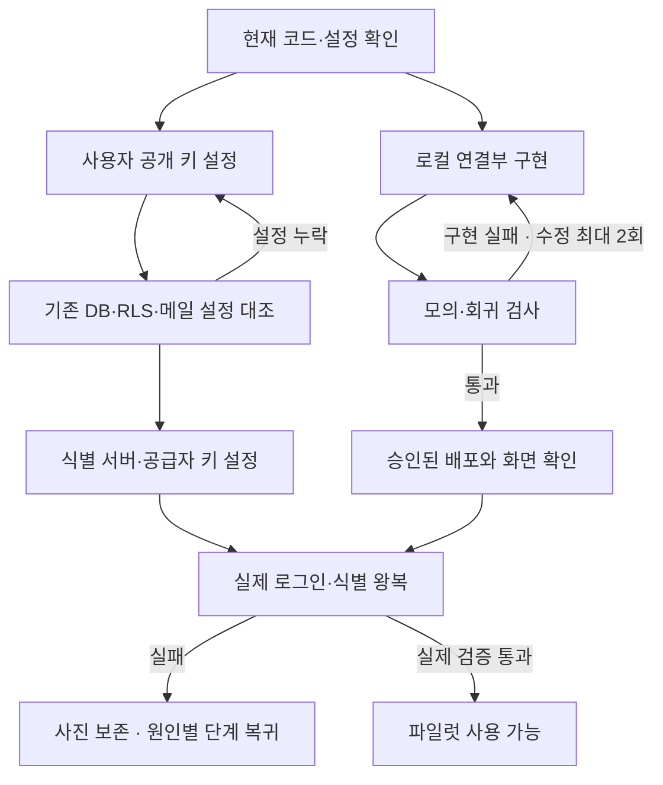

# 관찰 연결 작업 계약 · 2026-10-26

기준: 8ee1a8a, 실제 Git .research/app-baseline. 주 담당 시스템 아키텍트가 구현/환경/경로를 수행하고 기존 QA 역할이 읽기 전용 독립 검토. 디자인·모델·연구 코어 변경 금지.

## 실행 환경
로컬 Next16/Vitest/Playwright/axe와 기존 Pages/GitHub 연결 재사용. OpenRig CLI 없음. expect는 실행하고 인증 오류면 반복하지 않고 기존 브라우저 검사로 보완. .env.local은 무시되는 로컬 설정; 비밀키는 기록/채팅/원격에 넣지 않는다. 사용자 사진 대신 합성/테스트 자료 사용.

## 순서·분기
현황 확인 → 식별 준비 검사(설정 없음/확인 중/지원 안 함/오류/준비 완료) → 로그인 확인 → 미로그인 초안이면 먼저 기기 저장 → 저장 기록에서 로그인 링크 요청 → 같은 브라우저로 복귀 → 기존 기록 열기 → 별도 동의 후 식별 → 후보 선택 → 같은 개체 재관찰.

개발 경로: 최소 구현 → 단위·관련 브라우저 검사 → 독립 QA → 빌드 → 기존 승인 범위 내 Git/Pages → 공개 화면 확인. 계정 설정 대기는 로컬 구현을 막지 않는다. 실서비스 합류 조건은 프로젝트·DB/RLS·공개키·메일·공급자 키·실제 인증 왕복을 모두 확인한 뒤다.

## 검사·수정 반복
초기 실행 뒤 수정 재시도 최대2회. 구현 실패는 해당 코드 수정; 도구/인증 실패는 대체 검사 또는 해당 단계 대기. 같은 입력 재개 때 횟수 누적. 시간 초과를 성공으로 처리하거나 식별 요청을 자동 재전송하지 않는다.

## 완료 기준
1. 준비 확인 실패/지연/잘못된 응답에서 무한 대기 없이 수동 재시도하며 사진 저장 가능.
2. 미로그인은 사진 전송 안 함; 저장 전 로그인 이동 안 함; 저장 후 로그인 복귀 시 원 기록·메모·사진 유지하고 중복 생성 안 함.
3. 식별 취소·실패가 후보 성공으로 합류하지 않음. 기존 후보 저장·재관찰 시험 유지.
4. 로컬 모의, 실제 연결, 배포 증거 분리. 외부 설정 누락은 대기 상태로 남김.

## 시작 상태
촬영/기기 저장/재관찰: 기존 구현, 10/25 검사 증거. 로그인/외부 식별: 운영 미연결. Supabase Healthy(10/26 UI), 마지막 migration create_obs_photos_storage_bucket 존재: DB가 비어 있다고 가정하지 않음. 공개키 입력은 사용자에게 요청. 다음은 실제 스키마 읽기 전용 대조 후 필요한 migration만 적용.

## 개발 경로 요약

이 경로는 개발 지침이며 새 자동 실행 서버가 아니다. 사용자 설정 없이 실서비스 단계로 합류하지 않는다.

## 후속 실행 · 2026-10-28

공개 키와 로그인 복귀 주소 입력 후의 최신 완료 기준·담당·실행 증거는 [session-20261028/PLAN.md](session-20261028/PLAN.md)와 [VALIDATION.md](session-20261028/VALIDATION.md)를 따른다. 이전 시작 상태를 현재 서비스 상태로 해석하지 않는다. 인증 집중 검사는 `npm run test:cloud-auth`이며 CI에도 연결했다.
