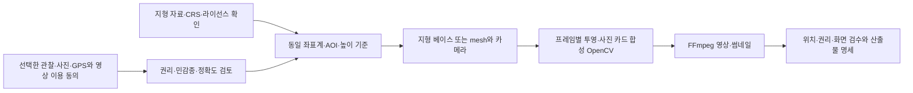

# 실제 지형 위에 관찰 사진을 띄우는 시연 영상 — 후속 설계

상태: **설계만 완료 / 미구현 / 영상 미제작**, 2026-11-03. 현재 지도 구현·원격 DB·배포와 별도 후속 작업이다.

## 사용자 의도와 현재 사실

사용자 요청: “추후 실제 매핑된 산을 오픈CV로 랜더링하여 그동안 수집된 gps 데이터로 사진을 띄우는 시연 영상도 만들거니까 설계 해둬. 기억하고”. 대상은 안성 보개면 양복리–금광면 오흥리의 청량산 주변이다. 실제 지형 위로 관찰 사진이 시간에 따라 나타나며, 참여자의 기록이 함께 쌓이는 가치를 보여준다. 현재 요청은 설계·기억이며 데이터 수집, 사진/GPS 반출, 영상 생성·외부 공개 승인이 아니다.

현재 `src/lib/location.ts`의 `PrivateLocation`은 `latitude`, `longitude`, `accuracy`, `capturedAt`이다. `src/lib/storage.ts`는 관찰 ID와 연결하여 브라우저 IndexedDB의 별도 `privateLocations`에 저장한다. 고도·카메라 방향·연속 이동 경로는 이 규격에 없다. 기기별 실제 GPS/사진 보유량과 이용 가능성은 아직 조사하지 않았다. 중앙에 GPS 데이터셋이 쌓여 있다고 가정하지 않는다.

커뮤니티 지도의 `map_area_id`와 대표 좌표는 동의한 공개 구역이며 실제 촬영 좌표가 아니다. 이것을 정밀 GPS로 복원하거나 대체하지 않는다. 공개 구역만 쓰는 영상은 “구역별 관찰 모음”으로 표시한다.

## 첫 제작 범위

**2.5D MVP 권고:** 검증한 DEM/DSM에서 음영·등고선 지형 베이스를 만들고, 고정 사선 또는 탑뷰 카메라로 작은 이동·확대를 준다. 각 관찰의 표시 위치와 사진 카드, 날짜, 연결선을 OpenCV 프레임 합성으로 얹고 FFmpeg로 인코딩한다. 목표 초안은 1920×1080, 30fps, 45–60초이며 실제 제작 때 확정한다.

OpenCV는 지형을 수집하거나 완전한 3D 장면을 자동 생성하는 도구가 아니다. 지형 자료 확보·좌표 변환·카메라 설정이 먼저 필요하다. `projectPoints`는 이미 정의된 3D 점과 카메라 내부/외부 파라미터를 영상 좌표로 투영한다. GPS만으로 원본 사진의 카메라 자세를 복원할 수 없으므로 사진은 지리적 앵커에 연결된 카드로 보여준다. [OpenCV 공식 자세·투영 예제](https://github.com/opencv/opencv/blob/5.x/doc/py_tutorials/py_calib3d/py_pose/py_pose.markdown)

**진짜 3D 대안:** 산 능선 뒤로 이동하는 카메라, 정확한 가림·조명·사진 빌보드가 필요하면 DEM→mesh를 Blender 등 전용 렌더러에서 렌더링하고, 동일한 카메라 행렬·depth pass를 OpenCV 카드 합성에 전달한다. OpenCV 자체에 범용 3D 렌더러를 새로 만드는 범위는 피한다. 2.5D에서 원근 왜곡을 적용하면 베이스와 앵커에 같은 변환을 적용하며, 가림을 계산하지 않은 결과를 실제 3D 가시성으로 설명하지 않는다.

## 데이터와 제작 흐름

1. **자료 준비:** 산 주변의 확정 AOI, 지형 원본, 촬영일/갱신일, 해상도, NoData/보간 여부, 수평·수직 기준, 라이선스·크레딧을 manifest에 기록한다. 지형 경계는 사용자 확인 지도 핀·공식 지형 자료를 대조한다.
2. **관찰 선택:** 명시적으로 내보내도록 선택한 기록만 별도 비공개 작업 폴더에 가져온다. 일반 앱 백업이나 공개 지도 API에 GPS 필드를 추가하지 않는다. 사진과 위치는 관찰 ID로 결합하고 누락·중복·권리 미확인 항목은 제외 이유를 남긴다.
3. **품질 정리:** 시간·좌표 범위·GPS 정확도·민감종·철회 상태를 검사한다. GPS가 없으면 사진은 비위치 목록으로만 사용하거나 제외한다. 정확도가 낮은 점은 불확실성 영역으로 표시하거나 제외한다. 정밀도를 임의로 높이지 않는다.
4. **좌표 정합:** 위경도→AOI에 맞는 미터 단위 투영 CRS→지역 원점 기준 좌표→DEM 높이→카메라 좌표→화면 픽셀 순서로 변환한다. GeoJSON은 `[longitude, latitude]`, OpenCV 카메라 좌표는 x 오른쪽/y 아래/z 전방으로 변환표를 고정한다. raster의 pixel-center/area 의미와 affine transform도 기록한다. [GDAL 좌표·해상도 변환](https://gdal.org/en/stable/programs/gdalwarp.html)
5. **합성:** 날짜 순으로 점·사진 카드가 나타나되 같은 장소는 겹침을 피한 카드 배치와 원래 앵커 연결선을 사용한다. 카드 배치 이동은 실제 좌표 이동과 분리한다. 프레임 번호와 시간은 고정 FPS로 계산하고 난수 사용 시 seed를 고정한다.
6. **출력:** 무손실 프레임 또는 파이프 입력을 FFmpeg에 전달한다. 코덱·FPS·해상도·색공간·오디오 유무·도구 버전과 명령을 기록한다. 비공개 GPS 원본·내부 ID·개인 경로는 배포용 폴더에 포함하지 않는다.

## 최소 입력 계약

| 묶음 | 필요한 필드·규칙 |
|---|---|
| 관찰 | `observation_id`, `observed_on`, `observed_at?`, `timestamp_source`, `timezone`, `species_label`, `identification_status`, `protection`, 연결이 확인된 경우만 `specimen_id` |
| 사진 | 비공개 원본 참조, `photo_sha256`, 제작용 정제 사진 참조, 저작권자/허용 용도/크레딧, 사람·개인정보 검토 결과 |
| GPS | `latitude`, `longitude`, `accuracy_m`, `gps_captured_at`, `horizontal_crs`, 출처 기기/입력 방식. 기존 `capturedAt`은 GPS 취득 시각이며 사진 촬영 시각과 동일하다고 단정하지 않음 |
| 높이 | `altitude_m?`, `vertical_datum?`, `altitude_accuracy_m?`; 없으면 DEM 표면 높이를 사용하고 `height_source=dem_surface`로 명시. 관찰자가 측정한 고도로 표시하지 않음 |
| 위치 공개 | `display_location_mode`(정확/완화/구역/비위치), 실제 표시 좌표 또는 공개 구역, 좌표 변환 버전. 정밀 원본과 공개 표시 위치를 분리 |
| 동의·검수 | 사진 이용과 **영상의 해당 위치 정밀도·배포 대상**을 포함한 별도 동의 ID·버전·시각·철회 상태, 검수 상태. 앱 업로드·지도 동의를 영상 공개 동의로 자동 승계하지 않음 |
| 지형·실행 | source URL/asset ID·checksum·취득일·해상도·CRS/수직 기준·라이선스, AOI, 카메라/투영, 편집 순서, 도구 버전·설정 hash |

공개 영상에는 `protection=protected`와 `unknown`을 좌표·사진 카드 모두에서 기본 제외한다. 이름을 바꾸거나 좌표만 숨겨도 서식지 단서가 남을 수 있으므로 자동 우회하지 않는다. `common`도 동의·검수를 통과해야 한다. 평가 사진은 편입하지 않는다. 제작 직전·공개 직전 동의/철회를 다시 확인하고, 철회 시 어떤 산출물을 재생성·교체해야 하는지 추적한다. 이미 공개된 영상의 사본까지 회수된다고 약속하지 않는다.

## 지형 선택과 높이 기준

첫 후보는 정식 이용 조건을 확인한 국내 지형 자료이며, 확보가 어렵다면 Copernicus GLO-30을 지역 개괄용 후보로 검토한다. GLO-30은 약 30m 해상도의 **DSM**으로 수목·건물 표면을 포함하며, 순수 지면 DTM이나 개별 나무의 정밀 측량 결과가 아니다. 수평 기준 WGS84와 수직 기준 EGM2008을 원본 메타데이터에서 확인한다. 확대한다고 지형 정확도가 좋아지지 않는다. [Copernicus 공식 자료·기준·이용 조건](https://dataspace.copernicus.eu/explore-data/data-collections/copernicus-contributing-missions/collections-description/COP-DEM)

GPS 고도가 추후 생겨도 타원체고와 DEM의 정표고를 그대로 섞지 않는다. 변환에 필요한 geoid 모델·단위를 확인하지 못하면 DEM 기반 높이만 사용한다. 수목 표면 위 사진 앵커의 시각적 높이 offset은 측정 고도와 별도 연출값으로 기록한다. 원본 고도 과장은 기본 1배로 두며 과장 시 영상에 표시한다.

관찰 시각이 날짜만 있으면 일 단위로만 전개한다. 같은 날짜 안의 표시 순서는 편집 순서이며 실제 시간순이라고 설명하지 않는다. 서로 다른 사람의 독립 관찰점을 이어 이동 경로로 만들지 않는다. 같은 개체의 전후 비교도 검증된 `specimen_id` 연결에 한정한다.

## 짧은 시연 구성

- 0–8초: 실제 지형의 전체 모습과 지역명·관찰 기간. “이 산에서 우리가 만난 생명들”.
- 8–25초: 날짜가 흐르며 승인된 관찰점이 하나씩 생기고 사진 카드가 열린다. 참여 인원/기록 수는 검증된 입력에서만 집계한다.
- 25–42초: 한 구역을 가까이 보고 여러 사진을 차례로 보여준다. 같은 개체의 재관찰이 확인되면 계절 변화 두 장을 비교한다.
- 42–55초: 전체 지형으로 돌아오며 기록이 모인 모습을 보여준다. “한 사람의 발견이 함께 보는 기록으로”. 관찰이 없는 곳을 생물이 없는 곳으로 표현하지 않는다.
- 마지막: “내 주변의 발견도 남겨 보세요”와 데이터 기간·위치 표시 수준·필수 크레딧. 배경음악은 권리 확인된 경우에만 추가한다.

## 향후 실행 구조 — 아직 만들지 않음

실제 앱 Git의 현재 npm/Nx 구조를 유지한다. 제작을 시작할 때만 `tools/terrain-video/` 같은 독립 Python adapter 프로젝트와 전용 `pyproject.toml`·`uv.lock`·가상환경을 검토한다. Claude 소유 연구 Python 환경·모델은 옮기거나 공유하지 않는다. Node 웹 앱에서 Python 소스나 정밀 GPS 파일을 import하지 않는다.

향후 Nx 연결 후보는 `inputs-validate → terrain-prepare → observations-project → render-frames → encode → verify-video`이며, 앱 HTTP 서비스가 아니라 명시적 파일 계약으로 연결한다. 지형 준비·투영 결과는 입력 hash로 재현하고, 비공개 사진·GPS가 들어가는 산출물은 Nx 원격 캐시/공개 CI artifact에 올리지 않는다. 대용량 프레임 캐시도 기본 비활성으로 둔다. 이 문서는 Nx target·uv 환경·패키지 설치가 존재하거나 실행됐다는 증거가 아니다.

## 제작 시 통과 조건

1. **위치 정합:** 알려진 지형 기준점 최소 3개와 AOI 모서리의 위치·방향을 시각 대조하고 수평 잔차를 m/픽셀로 기록한다. 허용 오차는 실제 GPS 정확도와 DEM 해상도를 고려해 제작 전에 정한다. 합성 fixture의 투영 수학은 1px 이내로 검사하되 실제 지도 정확도와 혼동하지 않는다.
2. **높이·가림:** NoData, AOI 밖 좌표, 카메라 뒤 점, frame 밖 카드, mesh 뒤 앵커를 처리한다. 3D 방식이면 depth와 카드 앵커의 가림이 일치한다.
3. **시간·내용:** 날짜/시간대·시각 출처, 입력 건수/제외 건수, 사진 hash가 일치한다. 독립 관찰자를 연결한 가짜 경로나 확인되지 않은 생물종 확정 표현이 없다.
4. **개인정보·권리:** 보호/미확인종, 철회/무동의, 정밀 GPS 포함 fixture가 공개 export에 들어가지 않는지 확인한다. 영상의 실제 위치 표현·사진 배경까지 육안 검수한다. 썸네일·자막·메타데이터·동봉 manifest에도 private GPS/경로/소유자 ID가 없다.
5. **라이선스:** 지형·항공사진·지도·폰트·사진·음악의 영상 이용·표시 조건을 기록한다. FFmpeg/OpenCV의 실제 버전·빌드와 코덱 옵션을 확인하고, 실행 도구 재배포 여부에 맞게 라이선스를 검토한다. 특정 빌드의 라이선스를 이름만으로 단정하지 않는다.
6. **재현·출력:** 입력 manifest+설정으로 프레임 수·배치·편집 순서를 재현한다. 1080p 샘플의 텍스트·겹침·깜박임·빈 프레임·프레임 수/FPS/길이를 검사한다. 비트 단위 인코딩 동일성은 별도 조건으로 둔다.

다음 시작점: 실제 사용 가능한 지형 원본과 사용자가 선택한 GPS/사진 표본의 존재·이용 동의를 확인하고, 3개 기준점·10개 이하 관찰로 5–10초 정합 시험을 먼저 만든다. 현재는 표본 수집·내보내기·렌더링을 수행하지 않았다.
