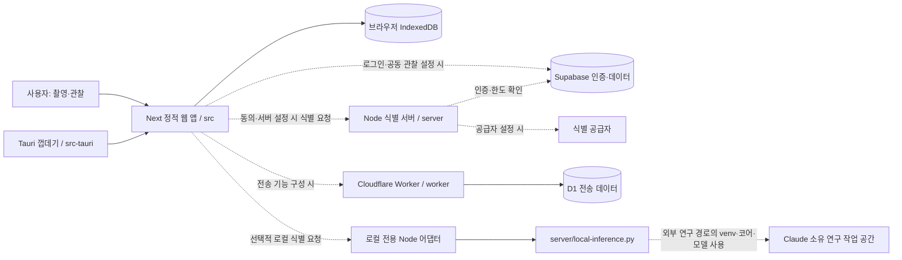
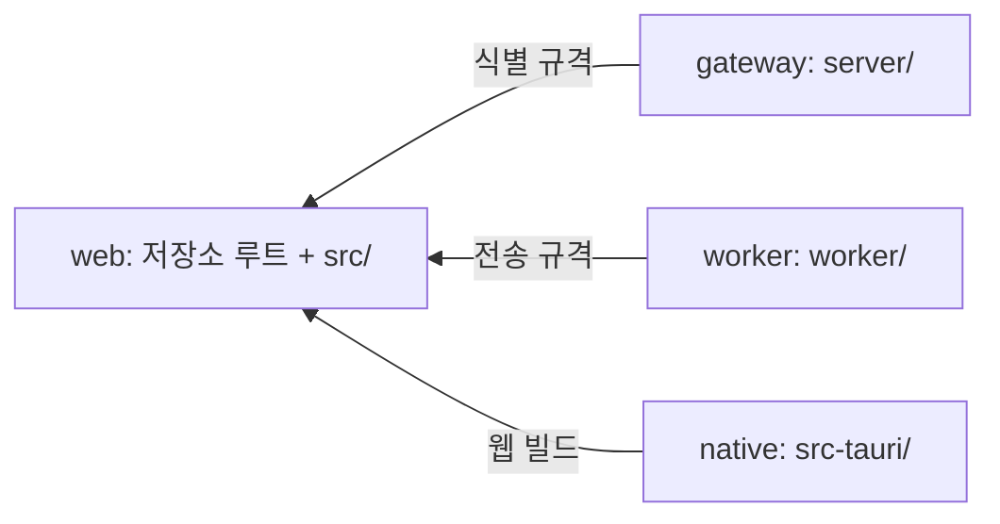

# 앱 작업 그래프 1단계

기준: 앱 Git `8250cb6241196f6d09b0687472278993187fda15`의 작업 트리, 2026-11-02. 이 구성은 기존 앱 위에 추가한 **작업 공간의 첫 단계**다. 독립 패키지로 분리된 모노레포나 서비스 통합 완료를 뜻하지 않는다. 화면·식별 모델·연구 코어·배포 명령은 이 단계에서 바꾸지 않았다.

## 앱에서 데이터가 흐르는 경로

아래는 소스에서 확인한 가능한 경로이며 모든 외부 기능의 현재 연결 성공을 뜻하지 않는다. 외부 식별에는 해당 화면의 동의와 서버 설정이 필요하다.



- `next.config.ts`는 정적 내보내기다. 기존 `npm run build`의 `out/`을 Pages 등에서 제공한다. `wrangler.jsonc`는 정적 자산과 API를 함께 제공하는 Worker 구성이며 `deploy/pages/wrangler.jsonc`는 별도 Pages 구성을 가리킨다.
- `render.yaml`의 서버 빌드·시작은 각각 `npm ci --omit=dev`, `npm run identify:server`다. GitHub Actions는 `.github/workflows/deploy.yml`의 기존 npm 명령을 사용한다. 어느 배포 경로도 Nx로 교체하지 않았다.
- 로컬 모델 경로는 선택 사항이다. `server/local-identification.mjs`가 `NATURE_LENS_RESEARCH_DIR` 또는 기존 기본 경로 아래 `.venv/bin/python`을 실행하고, 앱 안의 `server/local-inference.py`가 그 연구 경로의 `refimpl`과 `.models`를 읽는다. 이 작업에서 실제 모델 실행이나 Python 환경 이전은 하지 않았다.

## 개발 작업 그래프



화살표는 Nx 프로젝트 의존 방향이다. HTTP 연결이나 실제 배포 순서를 뜻하지 않는다. `gateway`는 `src/lib/ai/contract.ts`, `worker`는 `src/lib/transfer-contract.ts`를 사용한다. 두 규격이 아직 `src/`에 있으므로 현재 의존은 프로젝트 단위로 넓게 표현했다. 네이티브 빌드는 기존 웹 빌드 명령을 사용한다. 루트 `package.json`과 루트 `project.json`은 같은 `web` 프로젝트로 합쳐지며, 다른 프로젝트는 해당 하위 디렉터리를 소유한다. npm 스크립트 자동 추론은 꺼서 배포·실서비스 명령이 의도치 않게 Nx 대상이 되지 않는다.

| 프로젝트 | 명시한 작업 | 비고 |
|---|---|---|
| `web` | `dev`, `build`, `test`, `typecheck`, `boundary` | 기존 전체 Vitest 스위트는 게이트웨이 목업 검사도 포함한다. |
| `gateway` | `serve`, `test` | `test`는 기존 게이트웨이 관련 테스트만 별도 실행한다. |
| `worker` | `dev`, `typecheck`, `local-integration` | `local-integration`은 로컬 Worker와 임시 D1을 실행한다. |
| `native` | `doctor`, `web-build`, `mac-build` | 기존 Tauri 명령을 직접 연결한다. |

현재 `web:test`가 루트 `tests/`의 전체 모음을 실행하고 다른 프로젝트의 테스트도 포함하므로, 이 단계에서 `nx affected`만으로 전체 검증을 대체하지 않는다. 파일 소유권과 테스트 대상을 더 분리하기 전까지 아래 전체 로컬 검사를 사용한다.

## 사용과 캐시

앱 서버는 Node 22.18 이상을 요구하며 기존 npm 잠금 파일을 사용한다. CI는 Node 22, Render는 Node 22.22.2다. Nx 23.3.1과 경계 검사에 쓰는 Babel 파서는 정확한 버전으로 개발 의존성에 고정했다. 현재 공식 Nx 호환표에서 Node 22.12 이상을 지원하는 23.x를 택했다.

```sh
npm ci
npm run graph:local
npm run verify:local
```

`graph:local`은 그래프 JSON을 출력한다. `verify:local`은 웹 경계 검사와 그 자체의 테스트, 웹 타입 검사, 전체 Vitest 모음, Worker 타입 검사를 한 번씩 실행한다. 이 명령은 실제 외부 서비스·실제 사진·배포를 사용하지 않는다. 게이트웨이 테스트는 전체 모음에 포함되므로 별도로 중복 실행하지 않는다. 추가로 로컬 Worker+D1 통합을 확인할 때만 `NX_LOAD_DOT_ENV_FILES=false npx nx run worker:local-integration`을 사용한다.

Nx Cloud는 끄고 `.nx/`는 Git에서 제외한다. 검증 명령은 Nx의 `.env` 자동 로딩도 끈다. 로컬 캐시는 순수 `worker:typecheck`에만 사용하며 입력은 Worker TypeScript 파일과 독립 tsconfig, import가 없는 공유 전송 규격, `package.json`·잠금 파일, Node 버전·OS·아키텍처다. 환경 파일이나 모델·사진을 캐시 입력에 넣지 않는다. 웹 빌드는 공개 환경값에 따라 결과가 바뀌고 Next가 자체적으로 환경 파일을 읽을 수 있으므로 캐시하지 않는다. 웹 테스트, 게이트웨이·Worker 실행, 로컬 통합, 네이티브 빌드도 캐시하지 않는다. Worker의 import나 tsconfig 상속이 늘면 입력을 재검토하거나 캐시를 꺼야 한다.

`web:boundary`는 `src/`의 일반 소스 파일에서 정적 문자열 import·re-export·동적 import·require가 `server/`로 향하는지 검사한다. `tsconfig.json`의 경로 별칭과 단순 템플릿 문자열도 확인한다. 심볼릭 링크로 연결된 소스, 계산된 동적 경로, 외부 패키지 내부, 브라우저 실행 중 동작은 검사하지 않는다. 보안 감사는 아니며 새 소스 구조나 경로 해석 방식이 생기면 검사 범위를 다시 검토한다.

## pnpm·uv 판단과 다음 단계

Ambient Lab의 Nx 작업 분리와 Python 소유 경계를 참고하되, 이 앱의 잠금 파일·CI·Render·Tauri 실행 계약은 npm에 맞춰져 있다. pnpm 전환은 추후 별도 작업으로 설치·CI·두 배포 경로와 Tauri를 함께 검증할 때 판단한다. 현재 사용 중인 npm과 혼용하지 않는다.

uv workspace는 여러 Python 패키지가 하나의 `uv.lock`과 환경을 공유하는 방식이다. 앱의 선택적 로컬 어댑터는 이미 별도 연구 작업 공간의 Python 환경과 모델을 사용한다. 소유자·의존성·모델 버전·어댑터 계약이 합의되기 전에는 연구를 앱 저장소로 옮기거나 빈 Python 패키지/가짜 uv 대상·잠금 파일을 만들지 않는다. 별도 소유를 유지한다면 독립 uv 프로젝트를 검토하고, 진짜 공통 환경이 필요할 때만 공동 workspace를 검토한다. 연구 저장소와 평가 사진은 변경하지 않았다.

출처: [Nx 기존 저장소 도입](https://nx.dev/docs/kb/adding-to-monorepo), [Nx 프로젝트 설정](https://nx.dev/docs/reference/project-configuration), [Nx Node 호환표](https://nx.dev/docs/technologies/node/introduction), [Nx 환경 변수](https://nx.dev/docs/reference/environment-variables), [uv workspace](https://docs.astral.sh/uv/concepts/projects/workspaces/). Next의 정적 export·환경 변수는 설치된 `node_modules/next/dist/docs/01-app/02-guides/`를 확인했다.

## 검증 기록

2026-11-02, macOS arm64·Node 22.23.3에서 환경 파일과 기존 빌드 결과물을 제외한 별도 복사본을 사용했다.

- `npm ci`: 통과. 별도 빈 폴더에서 Render와 같은 `npm ci --omit=dev`도 통과했다.
- `npm run graph:local`: `web`, `gateway`, `worker`, `native`와 위 의존 관계를 확인했다. 기존 배포 스크립트는 Nx 작업으로 추론되지 않았다.
- `npm run verify:local`: 4개 작업 통과. 기존 Vitest 21개 파일, 86개 테스트와 경계 검사 자체의 테스트 2개가 통과했고 웹·Worker 타입 검사도 통과했다.
- `worker:typecheck`: 두 번째 실행에서 로컬 캐시를 사용했다. 복사본의 공유 전송 규격을 임시로 바꾸자 캐시를 사용하지 않고 다시 검사했다.
- `npm run build`와 Nx `web:build`: 통과. 환경 파일이 없는 복사본에서 정적 페이지와 오프라인 셸을 생성했다.
- Nx `worker:local-integration`: 통과. 임시 로컬 Worker와 D1에서 암호화된 전송, 제한·만료·동시성 등을 검사했다.

브라우저 E2E, 네이티브 빌드·실기기, 실제 모델과 외부 API, 실제 배포는 이 작업에서 검증하지 않았다. 모의 테스트와 로컬 D1 성공을 실서비스 성공으로 해석하지 않는다.
