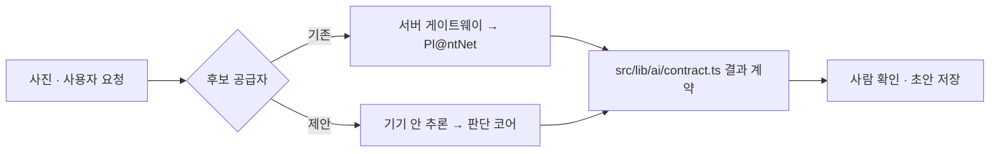

# 온디바이스 판단 코어 (제안)

확인 시각: 2026-10-13 KST. 상태: **설계 제안. 이 저장소에 코드 추가 없음, 구현 승인 전.**

## 1. 무엇인가
Seek의 판별 단계 중 **모델 추론 이후의 판단 로직**을 TypeScript 한 벌로 옮긴 것이다.
- 원본 위치: [bang1lee/claude-workspace](https://github.com/bang1lee/claude-workspace/pull/3) → `reverse-engineering/naturelens-seek/refimpl-ts/src/lens.ts`
- 맡는 일: 분류표 파싱, 위치를 H3 셀과 고도로 바꾸기(해안·섬 보정 `elevationFloor` 포함), 비전·위치 점수 결합(`geoWeight`), 분류 트리 합산, 임계값 적용, "근처 서식" 판정
- 맡지 않는 일: 모델 추론. `InferenceBackend { vision(), geo() }`로 주입받는다(브라우저 WebGPU/ONNX, Tauri, 모바일 TFLite, 서버 중 무엇이든).
- 맡지 않는 일: 299×299 리사이즈. 각 플랫폼 이미지 처리에 맡긴다.

## 2. 검증 상태
- Python 참조 구현이 실제 모델 출력과 판단 결과를 `golden.json`으로 내보낸다.
- TS는 같은 입력으로 64케이스를 같은 분류명, 점수 오차 0.01 이내, 같은 "근처 서식" 판정으로 재현한다.
- TS 테스트 74개, Python 테스트 17개, `tsc --noEmit` 통과(2026-10-15). Node 22에서 확인했다.
- **확인하지 않은 것:** 브라우저나 Tauri에서의 실행, 이 앱의 빌드와 정적 내보내기, 기기별 추론 속도, 리사이즈 차이에 따른 점수 변화.

## 3. 이 앱의 식별 흐름에 넣는 위치
현재 설계([AI-IDENTIFICATION-DESIGN.md](../../AI-IDENTIFICATION-DESIGN.md), [PLANT-IDENTIFICATION-FLOW-DESIGN.md](../PLANT-IDENTIFICATION-FLOW-DESIGN.md))는 서버 게이트웨이로 Pl@ntNet 후보를 받아 사람이 확인한다. 판단 코어는 이 흐름을 바꾸지 않고 **후보 공급자 하나를 추가**하는 방식으로 넣을 수 있다.

- 결과는 기존 결과 계약(`src/lib/ai/contract.ts`)으로 바꿔서 같은 검증을 거친다. 점수를 확정 확률로 보여 주지 않는다.
- "Life"나 계 수준에서 멈춘 결과는 "후보 없음 · 추가 사진 요청"으로 처리한다.
- 위치는 이미 저장하는 넓은 격자만 쓴다. 정밀 좌표는 판단 코어에 넣지 않는다.
- 해안·섬 관찰이 바다로 들어가지 않도록 `elevationFloor: 0`을 권한다. 기본값 확정은 평가 후에 한다.
- 기기 안 추론은 사진을 외부로 보내지 않는다. 그래도 별도 동의 화면과 "AI 보조" 표시는 유지한다.

## 4. 넣기 전 확인할 것
1. 모델 파일 크기와 첫 로드 시간(샘플 비전 모델 22MB). 정적 호스팅·오프라인 캐시 한도와의 관계.
2. 브라우저 추론 런타임 선택(WebGPU/WASM)과 저사양 기기 성능.
3. 공개 샘플 모델은 한국 성능이 낮다. 한국 종 모델 없이는 사용자 기능으로 내보내지 않는다 → [FINETUNE-ROADMAP.md](FINETUNE-ROADMAP.md)
4. 새 모델로 바꾸면 임계값 70의 의미가 달라진다. 보정 후 다시 정한다.
