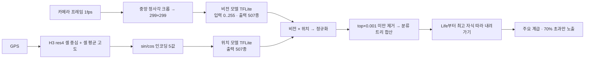

# Seek 온디바이스 판별 구조 분석

확인 시각: 2026-10-13 KST. 대상 커밋은 [README](README.md#분석-대상-고정-커밋) 참고. 앱 코드 변경 없음.

작성: Claude (Claude Code, Anthropic) 세션 https://claude.ai/code/session_016tEFHCFnPnN22Uk8qh7xwt . 이어지는 작업과 근거는 [HANDOFF.md](HANDOFF.md)를 본다.

## 1. 결론
Seek의 판별은 서버를 쓰지 않는다. 카메라 프레임을 초당 1장씩 **폰 안의 비전 모델**에 넣는다. 위치는 **H3 해상도 4 셀**(약 1,770km²)로 바꿔 **위치 모델**에 넣는다. 두 점수를 곱한 뒤 **분류 트리로 위로 합산**하고, 확신이 70%를 넘는 가장 깊은 단계(종, 속, 과 …)까지만 보여 준다.

## 2. 흐름

## 3. 근거
| 사실 | 블랙박스 근거 | 소스 대조 |
|---|---|---|
| 서버 판별 없음 | 번들 로그 "fetching online results has been removed" | — |
| 비전 입력 `[1,299,299,3]` float32, 출력 507 | TFLite 파싱 (CONV 42, DW-CONV 34, SOFTMAX) | `ImageClassifier.java` |
| 위치 입력 `[sin λ, sin φ, cos λ, cos φ, 고도/5705.63]` | 번들에 없음 | `GeoClassifier.normAndEncodeLocation` |
| 위치를 H3 res4 셀 중심으로 바꿈 | 번들 `latLngToCell(lat,lng,4)` | `src/lookUpLocation.ts` |
| 점수 결합 = 비전 × 위치 후 정규화 | 네이티브 | `combineVisionScores` |
| 노출 규칙: `rank_level % 10 == 0`, 점수 > 70 | 번들 필터 코드 | — |
| 실시간 카메라: 최근 5프레임 저장 후 공통 조상 산출 | 번들 `numStoredResults ?? 5` | — |
| 사람 포함 예측을 제한하는 함수가 있음 | export 이름만 확인 | 동작 미확인 |

## 4. 실측 (동작 확인용)
공개 샘플 모델(507종, 북미 중심)과 Seek 스토어 스크린샷에서 잘라 낸 사진 2장. 성능 벤치마크가 아니다.

| 사진 | 위치 없음 | 뉴욕 (Seek 방식) | 서울 (Seek 방식) | 서울 (위치 가중치 0.5) |
|---|---|---|---|---|
| 제왕나비 | 제왕나비 89.2% | 제왕나비 94.1% | **Life** | 제왕나비 87.7%, 이 지역에선 드묾 |
| 인디고번팅 (모델 밖 종) | 동물계 72.7% | 동물계 70.5% | **Life** | Life |

- 샘플 모델이 한국을 잘 몰라서, 서울에서는 위치 prior가 제대로 알아본 사진의 답까지 지운다.
- 모르는 종은 오답 대신 상위 분류("동물계")에서 멈춘다. 이 앱이 점수를 확정 확률로 보여 주지 않는 원칙과 같은 방향이다.

## 5. 함정
1. **입력 스케일:** v2 모델은 0..255를 받는다. 0..1로 넣어도 에러 없이 모든 사진에 같은 답이 나온다.
2. **제주·해안:** H3 res4 셀의 평균 고도라서 해안과 섬의 육지 지점이 바다로 들어간다. 2026-10-15에 한국 관찰 지점 31곳을 확인한 결과는 다음과 같다.
   - **16곳이 0 미만**이었다. 제주시 −21,802, 울릉도 −24,908, 독도 −32,768(표에 없음)이고, 강릉·속초·포항·울산·인천 송도 같은 본토 도시도 포함된다.
   - 고도를 0으로 올리면 지오 점수가 2배 넘게 바뀌는 종이 제주시 106종(최대 28배), 울릉도 180종에 이른다. 근처 서식 목록 자체는 조금만 바뀐다.
   - 판단 코어에 `elevationFloor` 옵션을 추가했다. 기본값은 Seek와 같다. 실제 판별 결과에 미치는 영향은 한국 평가셋으로 재야 한다. 바닥값 0은 부호만 고치므로, 한라산 중턱 같은 고지대는 휴대폰 GPS 고도를 쓰는 편이 낫다.
3. **축 전치 의심:** Seek Android 전처리는 `input[x][y]` 순서다. 사진 1장에서 85.9%가 79.1%로 떨어졌다. 미확정.

## 6. 이 앱에 대한 시사점
| 가져갈 것 | 이유 |
|---|---|
| 온디바이스 비전 + 위치 prior | 오프라인 동작, 공급자 호출 비용 없음, 사진 외부 전송 없음 |
| 분류 트리 롤업 + 임계값 | 모르면 상위 분류에서 멈춘다 |
| 위치를 넓은 격자로 바꿔 쓰기 | 정밀 좌표를 따로 보관하는 이 앱의 원칙과 맞는다 |

| 그대로 쓰면 안 되는 것 | 대안 |
|---|---|
| 공개 샘플 모델(507종, 북미 중심) | 한국 종 학습 필요 → [FINETUNE-ROADMAP.md](FINETUNE-ROADMAP.md) |
| 위치 × 비전 단순 곱 | 위치 가중치를 낮추고 "이 지역에선 드묾"으로 안내 |
| 플랫폼마다 따로 구현한 판단 로직 | TS 한 벌 → [ONDEVICE-DECISION-CORE.md](ONDEVICE-DECISION-CORE.md) |

## 7. 분석 도구(REA) 평가
[REA](https://github.com/morluto/rea)(`rea-agents` 6.4.0, MIT)로 13.5MB 번들을 분석했다(3분 30초, 탐지 312건). 엔드포인트 251개를 직접 검수한 결과는 다음과 같다.
- 118개는 iNaturalist SDK가 통째로 번들에 들어간 것이었다.
- 133개는 오탐이었다(네이티브 모듈 이름, 번역 키).

React Native 번들의 모듈 구조(Metro)는 복원하지 못했고, 스토어 APK의 Hermes 바이트코드는 읽지 못한다. 모바일 앱에서는 1차 목록 뽑기 수준이었다. 핵심 로직은 문자열·모듈 추적과 모델 파일 파싱으로 찾았다.
